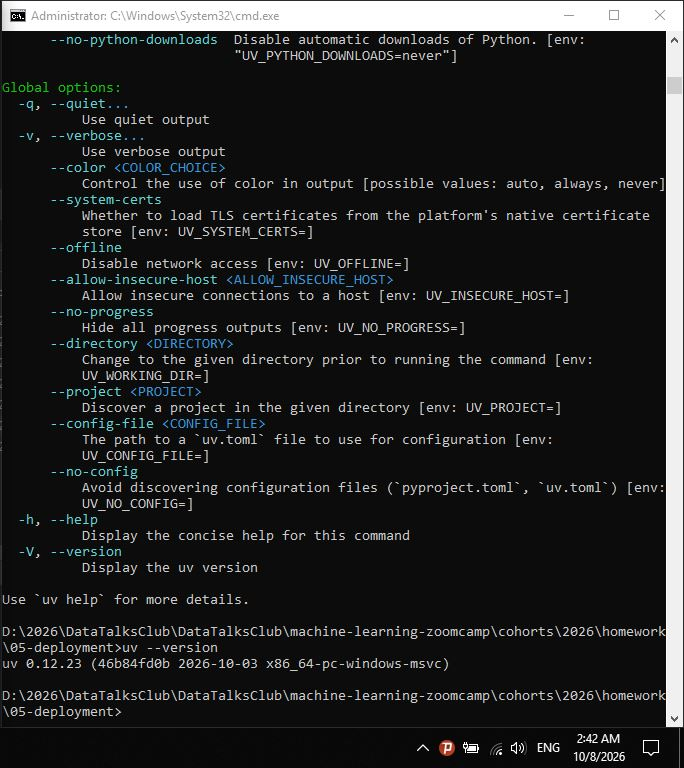
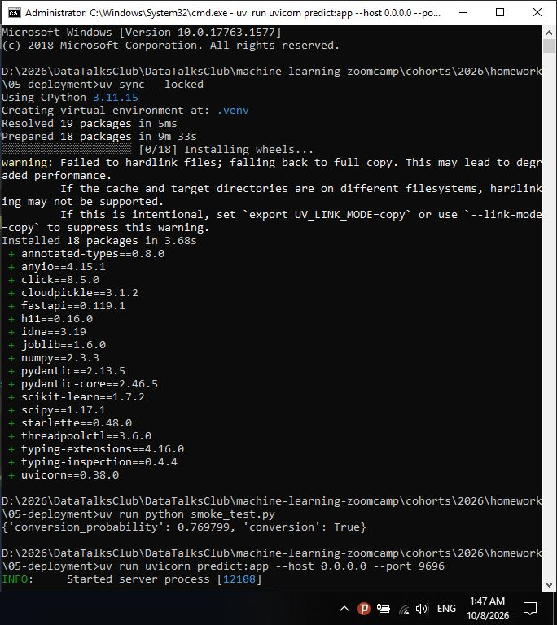
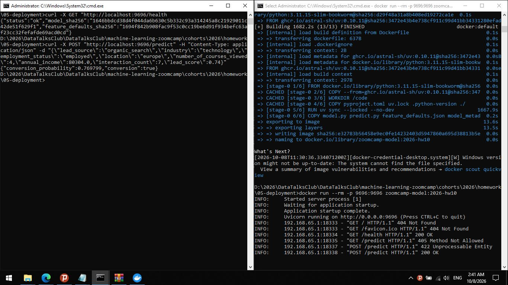
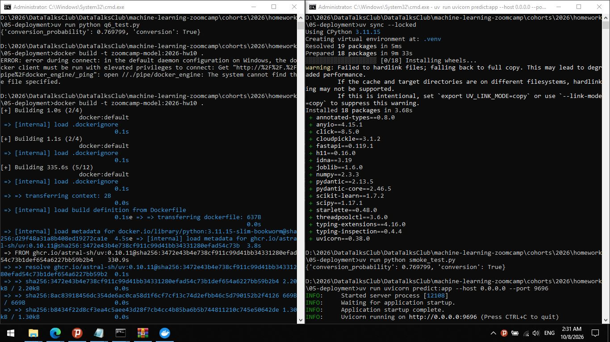
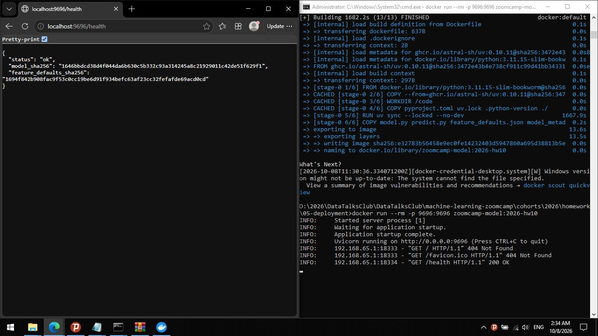
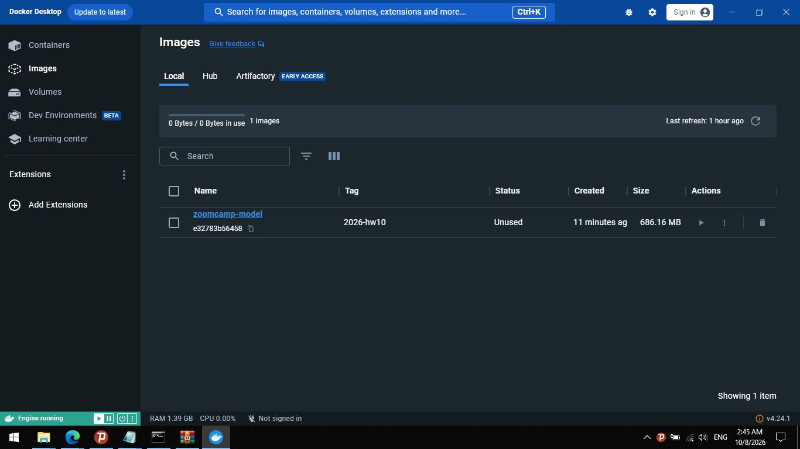
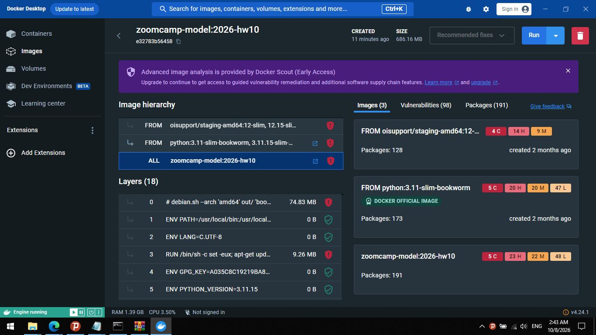

# Homework 5: Deploying Machine Learning Models

This document outlines the steps taken to complete Homework 5, covering environment setup, local testing, API deployment, and containerization using Docker.

## 1. Environment Setup & Dependency Check

First, I initialized the environment using `uv` and verified the locked dependencies. As seen in the output, `scikit-learn` version `1.7.2` is part of the reference environment.

**Commands used:**
```bash
uv sync --locked
uv --version
```
**Result:**
*   `uv` version: `0.12.23`
*   `scikit-learn` version: `1.7.2`

> Terminal showing the uv --help menu followed by the uv --version command returning version 0.12.23.


> 
---

## 2. Local Model Inference (Question 3)

I ran the provided smoke test script to verify that the checked-in model artifact loads correctly and produces deterministic inference locally.

**Command used:**
```bash
uv run python q6_test.py
```
**Result:**
```json
{'conversion_probability': 0.769799, 'conversion': True}
```
*Rounded to 3 decimal places: 0.770*

> Terminal showing successful uv sync command installing scikit-learn 1.7.2, followed by the successful execution of q6_test.py locally returning a conversion probability of 0.769799.


---

## 3. Serving the Model Locally (Question 4)

I started the FastAPI application locally using `uvicorn` to serve the model on port 9696.

**Command used:**
```bash
uv run uvicorn predict:app --host 0.0.0.0 --port 9696
```
After starting the server, I sent a POST request to the `/predict` endpoint with the provided JSON payload.

**Command used:**
```bash
curl -X POST http://localhost:9696/predict -H "Content-Type: application/json" -d "{...}"
```
**Result:**
```json
{"conversion_probability":0.769799,"conversion":true}
```
*Rounded to 3 decimal places: 0.770*

> Terminal output showing the Docker build process with the python:3.11.15-slim-bookworm base image, followed by the container starting and q6_test.py returning a conversion probability of 0.769799.

---

## 4. Building and Running the Docker Container (Question 5 & 6)

I built the Docker image using the provided `Dockerfile` and verified the base image tag. The base image used is `python:3.11.15-slim-bookworm`.

**Build Command:**
```bash
docker build -t zoomcamp-model:2026-hw10 .
```

> Terminal showing an initial Docker daemon connection error due to missing privileges, followed by a successful docker build process that resolves the python:3.11.15-slim-bookworm base image and builds the zoomcamp-model:2026-hw10 image.


Next, I ran the container, mapping port 9696, and verified the health endpoint. The health check confirmed the API was running and returned the correct model SHA256 checksum.

**Run Command:**
```bash
docker run --rm -p 9696:9696 zoomcamp-model:2026-hw10
```

**Health Check Verification:**
```bash
curl -s http://localhost:9696/health
```
**Result:**
```json
{
  "status": "ok",
  "model_sha256": "1646bbdcd38d4f044da6b630c5b332c93a314245a8c21929011c42de51f629f1",
  "feature_defaults_sha256": "1694f842b908fac9f53c0cc19be6d91f934befc63af23cc32fefafde69ac0cd"
}
```

> Web browser displaying the JSON response from http://localhost:9696/health, showing status ok and the model SHA256 checksum 1646bbdcd38d4f044da6b630c5b332c93a314245a8c21929011c42de51f629f1. 


Finally, I ran the `q6_test.py` script against the running container to verify the prediction endpoint. The result matched the local inference.

**Command used:**
```bash
python q6_test.py
```
**Result:**
```json
{'conversion_probability': 0.769799, 'conversion': True}
```
*Rounded to 3 decimal places: 0.770*

> Terminal output showing the Docker build process with the python:3.11.15-slim-bookworm base image, followed by the container starting and q6_test.py returning a conversion probability of 0.769799.


---

## 5. Docker Desktop Verification

I verified the built image and its layers using the Docker Desktop interface. The image `zoomcamp-model:2026-hw10` was successfully created with a size of 686.16 MB.

> Docker Desktop interface showing the zoomcamp-model:2026-hw10 image details, including its 686.16 MB size, 18 layers, and image hierarchy based on python:3.11-slim-bookworm.



---

## Summary of Results

| Question | Topic | Result |
| :--- | :--- | :--- |
| **Q1** | Environment check | `uv 0.12.23` |
| **Q2** | Locked dependency | `scikit-learn==1.7.2` |
| **Q3** | Load the model | `0.770` |
| **Q4** | Serve the model | `0.770` |
| **Q5** | Container configuration | `python:3.11.15-slim-bookworm` |
| **Q6** | Run the container | `0.770` |
```